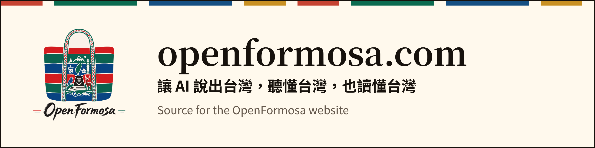

<p align="center"></p>

# openformosa.com

This repository is the source for [openformosa.com](https://openformosa.com). The site is built with Jekyll and deploys to GitHub Pages on every push to `main`.

<p align="center">
  <a href="LICENSE"></a>
  <a href="https://openformosa.com"></a>
  <a href="https://discord.gg/N4YnrjjcW7"></a>
</p>

<p align="center"><a href="README.md">繁體中文</a> · <b>English</b></p>

<p align="center">
  <a href="https://openformosa.com">Website</a> · <a href="SITE_COPY_AND_DESIGN_DECISIONS.md">Copy and design decisions</a> · <a href="docs/en/">Docs</a> · <a href="https://openformosa.com/community/">Community</a>
</p>

## Why

OpenFormosa's models, benchmarks, and release records live across many repositories and Hugging Face. First-time visitors need one entry point that shows which models they can try, which are still in progress, and how they can help.

This site is that entry point. It serves both researchers and the general public, and both paths lead to demos people can actually try.

## Quick start

1. Install dependencies:

   ```bash
   bundle install
   ```

2. Set a UTF-8 locale and start the local preview:

   ```bash
   export LANG=en_US.UTF-8 LC_ALL=en_US.UTF-8
   bundle exec jekyll serve
   ```

3. Open `http://127.0.0.1:4000/` to see the homepage.

Source files are UTF-8. macOS's default US-ASCII locale makes a bundled theme's SCSS fail, so step 2 sets the locale first.

## Installation

| Item | Requirement |
| --- | --- |
| Ruby | See `Gemfile`; install with Bundler |
| Node.js | Runs `scripts/validate-public-build.mjs` to validate the build |
| Locale | UTF-8 |

For a static preview that mirrors the deployed build:

```bash
export LANG=en_US.UTF-8 LC_ALL=en_US.UTF-8
bundle exec jekyll clean
bundle exec jekyll build
node scripts/validate-public-build.mjs _site
python3 -m http.server 4000 --bind 127.0.0.1 --directory _site
```

## Usage

### What the site includes

- Homepage with entry points for the model family, evaluation, training, and updates.
- Blog ("Log") with Jekyll posts, search, and tag filter.
- Model pages for OpenFormosa-Base (Barbet) and the ASR, TTS, and OCR branches.
- Evaluation and training pages for benchmark workflow, model recipes, release gates, and reproducibility artifacts.
- Training data sheet and model card templates.
- Bilingual UI (Traditional Chinese default, English fallback) through a lightweight `data-i18n` layer.
- GitHub issue templates for evaluation, training, reproducibility, and release work.

### Write a blog post

Posts live in `_posts/*.md` and are rendered with kramdown and GitHub-flavored Markdown, with MathJax loaded. Wrap each language of a bilingual post in `<div class="post-lang-zh" markdown="1">` and `<div class="post-lang-en" markdown="1">`. See [docs/en/blog-authoring.md](docs/en/blog-authoring.md).

### Change copy or layout

Before editing any page, read [SITE_COPY_AND_DESIGN_DECISIONS.md](SITE_COPY_AND_DESIGN_DECISIONS.md). It records the site's wording, punctuation, type sizes, and visual decisions.

### Deploy

Every push to `main` runs [`pages.yml`](.github/workflows/pages.yml), which builds, validates, and deploys to GitHub Pages. For production URL variables, the custom domain, and local production tests, see [docs/en/deployment.md](docs/en/deployment.md). Check [PUBLICATION_CHECKLIST.md](PUBLICATION_CHECKLIST.md) before announcing changes.

## Documentation

- [Copy and design decisions](SITE_COPY_AND_DESIGN_DECISIONS.md)
- [Deploying to GitHub Pages](docs/en/deployment.md)
- [Blog Markdown and LaTeX](docs/en/blog-authoring.md)
- [Publication checklist](PUBLICATION_CHECKLIST.md)
- [Governance](GOVERNANCE.md), [brand guidelines](TRADEMARK.md)

## Limitations

- This site documents model training, evaluation, and release evidence. It does not collect community datasets or accept raw data uploads.
- Social-sharing OG and Twitter metadata stay in English on purpose.

## Contributing

OpenFormosa is a community project. Everyone can be a contributor.

- Questions and discussion: [Discord](https://discord.gg/N4YnrjjcW7) or the [community page](https://openformosa.com/community/)
- Bugs and ideas: [Issues](https://github.com/OpenFormosa/openformosa.com/issues)
- Pull requests: read [CONTRIBUTING.md](CONTRIBUTING.md) first
- General contact: <hello@openformosa.com>
- Security: <security@openformosa.com> (please do not open a public issue); see [SECURITY.md](SECURITY.md)
- Code of conduct: [CODE_OF_CONDUCT.md](CODE_OF_CONDUCT.md); report to <conduct@openformosa.com>

## License

Code and content in this repository are released under the [Apache License 2.0](LICENSE), © 2026 OpenFormosa contributors. Contributions made before 2026-11-28 were originally released under the MIT License and remain available under it; see [NOTICE](NOTICE).

Use of the OpenFormosa name and Gaji-bag logo is described in [TRADEMARK.md](TRADEMARK.md).

## Acknowledgements

Compute and research support come from Taipei-1, NTU Speech Lab, and NTU SPML Lab. Thanks to everyone who opened an issue, sent a pull request, or joined the discussion.
