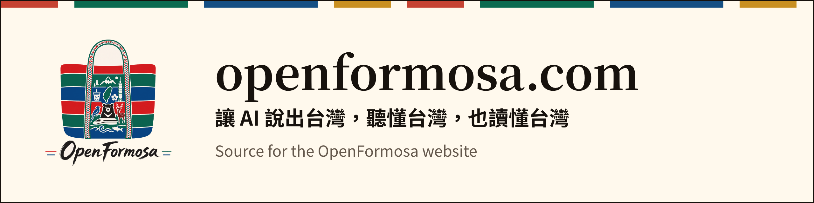

<p align="center"></p>

# openformosa.com

這個 repository 是 [openformosa.com](https://openformosa.com) 的原始碼。網站用 Jekyll 建置，推送到 `main` 後會自動部署到 GitHub Pages。

<p align="center">
  <a href="LICENSE"></a>
  <a href="https://openformosa.com"></a>
  <a href="https://discord.gg/N4YnrjjcW7"></a>
</p>

<p align="center"><b>繁體中文</b> · <a href="README.en.md">English</a></p>

<p align="center">
  <a href="https://openformosa.com">網站</a> · <a href="SITE_COPY_AND_DESIGN_DECISIONS.md">文案與設計決定</a> · <a href="docs/en/">文件</a> · <a href="https://openformosa.com/community/">社群</a>
</p>

## 為什麼做這個

OpenFormosa 的模型、評測與發布紀錄分散在不同 repository 與 Hugging Face。第一次來的人需要一個入口，快速知道哪些模型可以試、哪些還在研發，以及自己可以怎麼參與。

這個網站就是那個入口。它同時服務研究人員與一般大眾，兩條路都導向可以實際試用的 demo。

## 快速開始

1. 安裝相依套件：

   ```bash
   bundle install
   ```

2. 設定 UTF-8 語系並啟動本機預覽：

   ```bash
   export LANG=en_US.UTF-8 LC_ALL=en_US.UTF-8
   bundle exec jekyll serve
   ```

3. 打開 `http://127.0.0.1:4000/`，會看到網站首頁。

原始檔是 UTF-8。macOS 預設的 US-ASCII 語系會讓主題的 SCSS 出錯，所以第 2 步要先設定語系。

## 安裝

| 項目 | 需求 |
| --- | --- |
| Ruby | 見 `Gemfile`，以 Bundler 安裝 |
| Node.js | 執行 `scripts/validate-public-build.mjs` 驗證建置結果 |
| 語系 | UTF-8 |

想預覽和正式部署相同的靜態建置：

```bash
export LANG=en_US.UTF-8 LC_ALL=en_US.UTF-8
bundle exec jekyll clean
bundle exec jekyll build
node scripts/validate-public-build.mjs _site
python3 -m http.server 4000 --bind 127.0.0.1 --directory _site
```

## 使用範例

### 網站包含什麼

- 首頁：模型家族、評測、訓練與最新消息的入口。
- 部落格（Log）：Jekyll 文章、搜尋與標籤篩選。
- 模型頁：OpenFormosa-Base（Barbet）以及 ASR、TTS、OCR 分支。
- 評測與訓練頁：評測流程、模型配方、發布關卡與重現資料。
- 訓練資料表與模型卡範本。
- 雙語介面：預設繁體中文，英文為輔，透過輕量的 `data-i18n` 層切換。
- GitHub issue 範本：評測、訓練、重現與發布工作。

### 寫一篇部落格文章

文章放在 `_posts/*.md`，以 kramdown 與 GitHub 風格 Markdown 轉換，並載入 MathJax。雙語文章用 `<div class="post-lang-zh" markdown="1">` 與 `<div class="post-lang-en" markdown="1">` 包住各自的語言。細節見 [docs/en/blog-authoring.md](docs/en/blog-authoring.md)。

### 修改文案或版面

改任何頁面前，先讀 [SITE_COPY_AND_DESIGN_DECISIONS.md](SITE_COPY_AND_DESIGN_DECISIONS.md)。它記錄了全站的用語、標點、字級與視覺決定。

### 部署

每次推送到 `main`，[`pages.yml`](.github/workflows/pages.yml) 會建置、驗證並部署到 GitHub Pages。正式網址的設定、自訂網域與本機正式建置測試，見 [docs/en/deployment.md](docs/en/deployment.md)。公開前請對照 [PUBLICATION_CHECKLIST.md](PUBLICATION_CHECKLIST.md)。

## 文件

- [文案與設計決定](SITE_COPY_AND_DESIGN_DECISIONS.md)
- [部署到 GitHub Pages](docs/en/deployment.md)（英文）
- [部落格 Markdown 與 LaTeX](docs/en/blog-authoring.md)（英文）
- [公開前檢查清單](PUBLICATION_CHECKLIST.md)
- [治理](GOVERNANCE.md)、[品牌使用規範](TRADEMARK.md)

## 限制

- 這個網站記錄模型訓練、評測與發布證據。它不收集社群資料集，也不接受原始資料上傳。
- 社群分享用的 OG 與 Twitter metadata 刻意維持英文。

## 參與貢獻

OpenFormosa 是社群專案，每個人都可以是貢獻者。

- 討論與提問：[Discord](https://discord.gg/N4YnrjjcW7) 或 [社群頁](https://openformosa.com/community/)
- 回報問題或提議功能：[Issues](https://github.com/OpenFormosa/openformosa.com/issues)
- 送出修改：請先讀 [CONTRIBUTING.md](CONTRIBUTING.md)
- 一般聯絡：<hello@openformosa.com>
- 安全問題：<security@openformosa.com>（請不要公開發 issue），見 [SECURITY.md](SECURITY.md)
- 行為準則：[CODE_OF_CONDUCT.md](CODE_OF_CONDUCT.md)，回報請寄 <conduct@openformosa.com>

## 授權

本 repository 的程式碼與內容以 [Apache License 2.0](LICENSE) 釋出，© 2026 OpenFormosa contributors。2026-11-28 以前的貢獻原以 MIT License 釋出，仍可依 MIT 使用，見 [NOTICE](NOTICE)。

OpenFormosa 名稱與茄芷袋標誌的使用方式見 [TRADEMARK.md](TRADEMARK.md)。

## 致謝

本專案的運算資源與研究支持來自 Taipei-1、臺大語音實驗室（NTU Speech Lab）與 NTU SPML Lab。感謝每一位提出問題、送出 PR 與參與討論的貢獻者。
